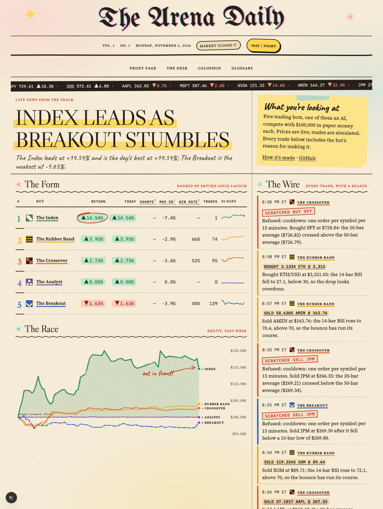
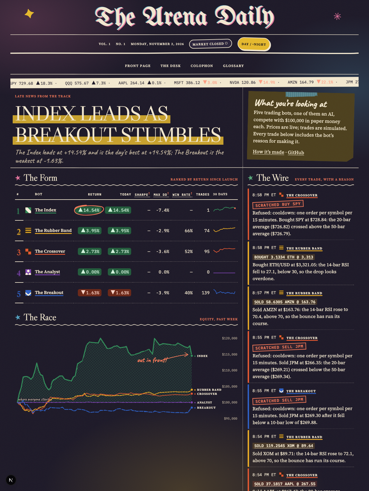
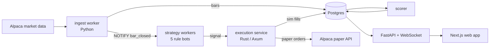

# Paper Trading Arena

[](https://github.com/fonseca04Lenin/bot-trading-arena/actions/workflows/ci.yml)

> **Status:** everything below is built and tested locally. The production deployment, the demo GIF and the
> uptime figures need the owner's Alpaca, Railway, Neon and Vercel accounts; see [deploy/README.md](deploy/README.md).
> The screenshots are from a local run on synthetic prices, not live market data.

**A live website where five rule-based trading bots compete with paper money in real time. Every trade comes with a plain-English explanation of why the bot made it.**

Live site: `arena.elvinfonseca.com` (not deployed yet).

The site is laid out as a daily newspaper, *The Arena Daily*: a leaderboard called The Form, a trade feed called The Wire, and a backtester called The Handicapper's Desk.

| Day edition | Night edition |
|---|---|
|  |  |

## Architecture



More detail in [docs/architecture.md](docs/architecture.md).

## What's interesting technically

1. **A Rust execution service** (Axum, sqlx, `rust_decimal`): idempotent order handling, the risk rules as pure functions, and one database transaction for each fill, position and cash change. It exits at startup unless it points at Alpaca's *paper* endpoint, and there is no live mode.
2. **A parked LLM agent built like a production feature.** The Analyst runs on rules for now, so the site costs nothing in API calls, but its LLM version is kept in the repo. Four read-only tools, a strict output contract validated with Pydantic, and guardrails in code: cited numbers must match what the tools returned, the universe and sizing are re-checked, and any schema failure turns the whole run into HOLD. Every run is logged with tokens and latency, and a daily call budget caps cost.
3. **Evals that run in CI without spending money.** 18 frozen scenarios (oversold dips, full portfolios, missing data, stale markets, adversarial outputs) replay recorded responses. The adversarial scenarios prove the guardrails drop bad proposals. See [evals/analyst/REPORT.md](evals/analyst/REPORT.md).
4. **One source of truth for strategies.** Strategies are pure functions, so the backtester and the live workers run the same code, and a test checks both produce the same signals.
5. **Event-driven with plain Postgres.** `LISTEN/NOTIFY` carries bar-closed, trade and equity events from workers to the WebSocket gateway; no Redis or Kafka.

## Run it locally

You need Python 3.12, Rust, Node 22 and Postgres 16 (Docker or Homebrew).

```bash
make setup      # venv, Python packages, npm install
make dev        # Postgres, migrations, execution, ingest, strategies, scorer, analyst, API, web
```

Open http://localhost:3000. With no API keys, prices come from a synthetic random walk
(`MARKET_DATA_SOURCE=synthetic`, refused in production).
Copy `.env.example` to `.env` to add keys. Stop everything with `make stop`.

## Tests

```bash
make test       # pytest (workers + API), cargo test, vitest
make lint       # ruff, mypy --strict, cargo fmt/clippy -D warnings, eslint, tsc
make eval       # replay the Analyst evals from recorded cassettes
make eval-live  # re-record the evals against the real model (spends money)
cd apps/web && npm run e2e   # Playwright smoke tests against a running stack
```

## Layout

```
apps/web/            Next.js front end
services/api/        FastAPI REST + WebSocket
services/workers/    ingest, strategies, scorer, analyst (Python package arena_workers)
services/execution/  Rust execution service
db/migrations/       dbmate-format SQL
evals/analyst/       scenarios, cassettes, runner, report
docs/                architecture, screenshots, resume numbers
```

## Credits

The execution service was written fresh for this project. It follows the design of the author's earlier
[alpaca-webhook-rs](https://github.com/fonseca04Lenin/alpaca-webhook-rs), whose code was not available when this was built.
Market data: Alpaca / IEX. Paper money only; not financial advice. MIT licensed.
